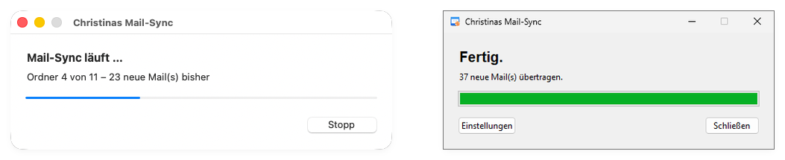
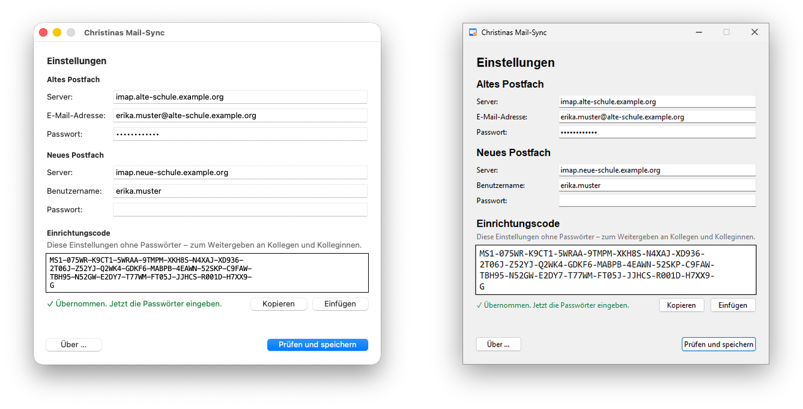

# Christinas Mail-Sync

Kopiert Mails von einem alten IMAP-Postfach in ein neues, zum Beispiel beim Wechsel des Mailanbieters.
Für Windows und Mac, ohne Installation von Zusatzprogrammen.

- **Jede Mail wird genau einmal übertragen.** Man kann so oft synchronisieren, wie man will.
- **Nur eine Richtung:** Im alten Postfach wird nichts verändert, im neuen wird nichts gelöscht.
- **Ordner bleiben erhalten**, ebenso Datum und Gelesen-Markierung.

  

<em>Ein Doppelklick genügt – links macOS während des Syncs, rechts Windows danach</em>

## Herunterladen und installieren

Unter [Releases](https://github.com/christinawietig/christinas-mail-sync/releases/latest):

**Mac** (mit Apple-Chip, ab 2020): `Christinas-Mail-Sync.dmg`

1. Die DMG-Datei doppelklicken.
2. **Christinas Mail-Sync** auf den Ordner **Programme** ziehen.
3. Die App aus dem Ordner Programme starten. macOS fragt beim ersten Mal, ob die aus dem Internet
   geladene App geöffnet werden soll: **Öffnen**.

**Windows:** `Christinas-Mail-Sync-Setup.exe`

1. Die Datei doppelklicken. Falls „Der Computer wurde durch Windows geschützt“ erscheint:
   auf **Weitere Informationen** und dann auf **Trotzdem ausführen** klicken.
2. Den Schritten folgen. Administratorrechte sind nicht nötig.
   Danach steht die App im Startmenü und auf Wunsch auf dem Desktop.

## Erster Start

**Danach** öffnet die App einmalig die Einstellungen:

1. Hat man einen **Einrichtungscode** bekommen (beginnt mit `MS1-`): ihn kopieren und in der App auf
   **Einfügen** klicken. Server und Benutzernamen sind dann eingetragen.
   Ohne Code füllt man die Felder von Hand aus.
2. Die beiden **Passwörter** eingeben.
3. Auf **Prüfen und speichern** klicken.

  

<em>Einstellungen mit eingefügtem Code – links macOS, rechts Windows</em>

Ab dann genügt ein Doppelklick: Die App synchronisiert sofort und zeigt am Ende, wie viele Mails übertragen wurden.

## Einrichtungscode weitergeben

Unten in den Einstellungen steht immer der Einrichtungscode zu den Feldern darüber.
Er ändert sich bei jeder Eingabe sofort mit. **Kopieren** klicken und den Code zum Beispiel per Mail verschicken.

- Der Code enthält Server, Benutzernamen und ausgeschlossene Ordner, **aber nie die Passwörter.**
- **Kolleginnen und Kollegen einrichten:** In den Einstellungen deren Adresse und Benutzernamen eintragen,
  **Kopieren** klicken und dann **Abbrechen**. Die eigenen Einstellungen bleiben unverändert.
  Die Kollegin fügt den Code ein und gibt nur noch ihre Passwörter ein.
- Leerzeichen, Zeilenumbrüche und Groß-/Kleinschreibung sind egal. Eine Prüfsumme erkennt,
  wenn der Code unvollständig kopiert oder vertippt wurde.

## Tipps

- Neue Mails am besten zuerst im **alten** Postfach in Ordner einsortieren und dann synchronisieren.
  Sie landen dann gleich im passenden Ordner im neuen Postfach.
- Was nach der Übertragung verschoben oder gelöscht wird, gilt nur in dem Postfach, in dem man es tut.
  Eine im neuen Postfach gelöschte Mail kommt nicht wieder.
- Ausgeschlossene Ordner (z. B. der Papierkorb) werden nicht übertragen. Sie kommen mit dem Einrichtungscode.
- Ein Abbruch mit **Stopp** schadet nicht. Beim nächsten Start geht es einfach weiter.

## Wo die Daten liegen

Alles bleibt auf dem eigenen Computer:

| Was | Wo |
|---|---|
| Passwörter | Schlüsselbund (Mac) bzw. Anmeldeinformationsverwaltung (Windows) |
| Server, Benutzernamen, Liste der übertragenen Mails, Protokolle | Mac: `~/Library/Application Support/Christinas Mail-Sync/` Windows: `%APPDATA%\Christinas Mail-Sync\` |

## So funktioniert es

Bei jedem Sync liest die App beide Postfächer neu ein, nur lesend, und vergleicht die Mails
anhand ihrer Message-ID. Übertragen wird nur, was im neuen Postfach fehlt **und** noch nie
übertragen wurde. Danach kopiert [imapsync](https://imapsync.lamiral.info/) Ordner für Ordner genau diese Mails.

Die Datei `uebertragen.txt` im Datenordner merkt sich zusätzlich alle Mails, die schon einmal
im neuen Postfach angekommen sind. Nur deshalb bleibt eine dort gelöschte Mail gelöscht.
Geht die Datei verloren, entstehen **keine doppelten Mails**, denn was im neuen Postfach liegt,
erkennt die App auch ohne die Datei. Nur im neuen Postfach gelöschte Mails würden dann noch einmal kopiert.

Die Verbindungen sind verschlüsselt, und die Zertifikate der Server werden geprüft.

## Lizenz

[MIT](LICENSE). Die mitgelieferte Software und ihre Lizenzen stehen in [THIRD_PARTY.md](THIRD_PARTY.md).
Hinweise zur Entwicklung stehen in [CLAUDE.md](CLAUDE.md).
