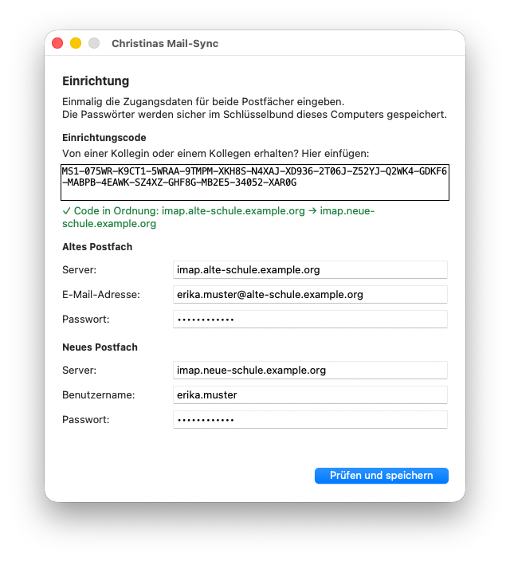
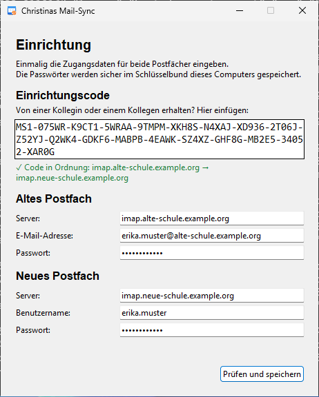
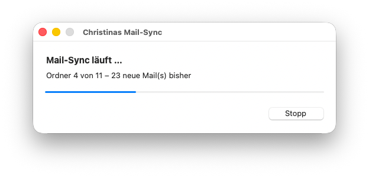
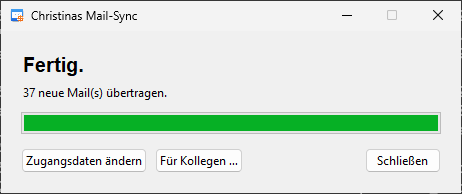
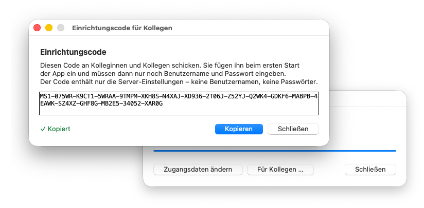

# Christinas Mail-Sync

Kopiert Mails von einem alten IMAP-Postfach in ein neues, zum Beispiel beim Wechsel des Mailanbieters.
Für Windows und Mac, ohne Installation von Zusatzprogrammen.

- **Jede Mail wird genau einmal übertragen.** Man kann so oft synchronisieren, wie man will.
- **Nur eine Richtung:** Im alten Postfach wird nichts verändert, im neuen wird nichts gelöscht.
- **Ordner bleiben erhalten**, ebenso Datum und Gelesen-Markierung.

<p align="center">
  
  
</p>
<p align="center"><em>Einrichtung beim ersten Start – links macOS, rechts Windows</em></p>

## Herunterladen

Unter [Releases](https://github.com/christinawietig/christinas-mail-sync/releases/latest):

- **Windows:** `Christinas-Mail-Sync-Windows.exe`
- **Mac (mit Apple-Chip, ab 2020):** `Christinas-Mail-Sync-macOS.zip`

## Erster Start

Die App ist nicht bei Apple oder Microsoft registriert. Deshalb warnt der Computer beim ersten Start einmalig.

**Mac**

1. Die ZIP-Datei doppelklicken und **Christinas Mail-Sync** in den Ordner **Programme** ziehen.
2. Die App doppelklicken. Es erscheint eine Warnung. Auf **Fertig** klicken.
3. **Systemeinstellungen → Datenschutz & Sicherheit** öffnen, ganz nach unten scrollen und bei
   „Christinas Mail-Sync“ auf **Dennoch öffnen** klicken.

**Windows**

1. Die Datei doppelklicken. Falls „Der Computer wurde durch Windows geschützt“ erscheint:
   auf **Weitere Informationen** und dann auf **Trotzdem ausführen** klicken.

**Danach** fragt die App einmalig nach den Zugangsdaten:

1. Den **Einrichtungscode** einfügen, den man von einer Kollegin oder einem Kollegen bekommen hat
   (beginnt mit `MS1-`). Damit sind die Server eingetragen. Ohne Code trägt man die Server von Hand ein.
2. E-Mail-Adresse bzw. Benutzername und Passwort für beide Postfächer eingeben.
   Der neue Benutzername wird nach Möglichkeit schon vorgeschlagen.
3. Auf **Prüfen und speichern** klicken.

Ab dann genügt ein Doppelklick: Die App synchronisiert sofort und zeigt am Ende, wie viele Mails übertragen wurden.

<p align="center">
  
  
</p>

## Einrichtungscode weitergeben

Wer die App eingerichtet hat, klickt nach einem Sync auf **Für Kollegen …** und dann auf **Kopieren**.
Den Code zum Beispiel per Mail weiterschicken.

<p align="center">
  
</p>

- Der Code enthält nur die Server-Einstellungen: Server, Ports, ausgeschlossene Ordner und wie sich
  der neue Benutzername aus der alten Adresse ergibt. **Keine Benutzernamen, keine Passwörter.**
- Leerzeichen, Zeilenumbrüche und Groß-/Kleinschreibung sind egal. Eine Prüfsumme erkennt,
  wenn der Code unvollständig kopiert oder vertippt wurde.

## Tipps

- Neue Mails am besten zuerst im **alten** Postfach in Ordner einsortieren und dann synchronisieren.
  Sie landen dann gleich im passenden Ordner im neuen Postfach.
- Was nach der Übertragung verschoben oder gelöscht wird, gilt nur in dem Postfach, in dem man es tut.
  Eine im neuen Postfach gelöschte Mail kommt nicht wieder.
- Ausgeschlossene Ordner (z. B. der Papierkorb) werden nicht übertragen. Sie kommen mit dem Einrichtungscode.
- Ein Abbruch mit **Stopp** schadet nicht. Beim nächsten Start geht es einfach weiter.

## Wo die Daten liegen

Alles bleibt auf dem eigenen Computer:

| Was | Wo |
|---|---|
| Passwörter | Schlüsselbund (Mac) bzw. Anmeldeinformationsverwaltung (Windows) |
| Server, Benutzernamen, Liste der übertragenen Mails, Protokolle | Mac: `~/Library/Application Support/Christinas Mail-Sync/`<br>Windows: `%APPDATA%\Christinas Mail-Sync\` |

Die Datei `uebertragen.txt` in diesem Ordner merkt sich, welche Mails schon übertragen wurden.
Wer sie löscht, bekommt Mails, die im neuen Postfach gelöscht wurden, beim nächsten Mal erneut.

## So funktioniert es

1. Die App liest die Message-IDs aller Mails in beiden Postfächern, nur lesend, und ermittelt die Mails,
   die noch nie übertragen wurden (`src/mailsync/plan.py`).
2. [imapsync](https://imapsync.lamiral.info/) kopiert Ordner für Ordner genau diese Mails (`src/mailsync/sync.py`).
3. Alles, was jetzt im neuen Postfach liegt, wird in `uebertragen.txt` vermerkt.

Die Verbindungen sind verschlüsselt, und die Zertifikate der Server werden geprüft.

## Entwicklung

Voraussetzungen: Python 3.13 mit Tk. Für den Mac-Build zusätzlich die Xcode Command Line Tools und Homebrew mit `openssl@3`.

```bash
python3 -m venv .venv && .venv/bin/pip install -r requirements.txt
./scripts/build-imapsync-macos.sh          # imapsync -> vendor/imapsync
.venv/bin/python -m unittest discover -s tests
PYTHONPATH=src .venv/bin/python -m mailsync  # App aus dem Quelltext starten
.venv/bin/pyinstaller --noconfirm mailsync.spec   # -> dist/
```

Die Windows-Version wird automatisch auf GitHub gebaut (`.github/workflows/build.yml`).
Die Screenshots erstellt der Workflow „Screenshots“ (`scripts/screenshots.py`, mit Beispieldaten).
Ein neues Release entsteht mit `git tag v1.x.y && git push --tags`.

## Lizenz

[MIT](LICENSE). Die mitgelieferte Software und ihre Lizenzen stehen in [THIRD_PARTY.md](THIRD_PARTY.md).
